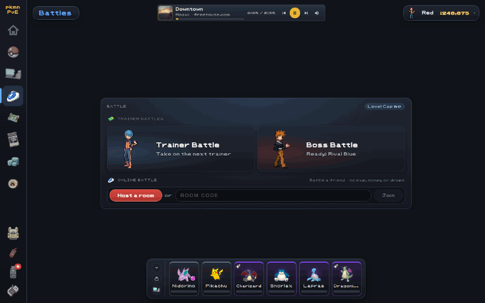
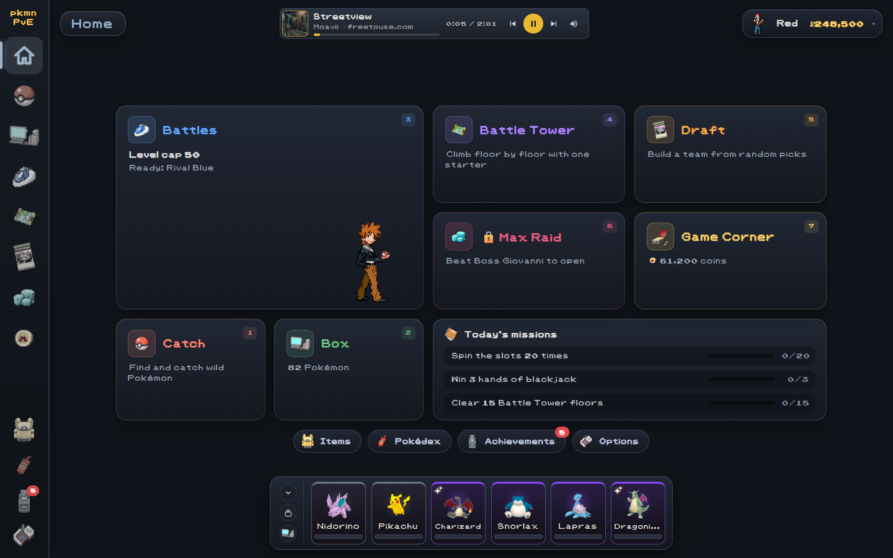
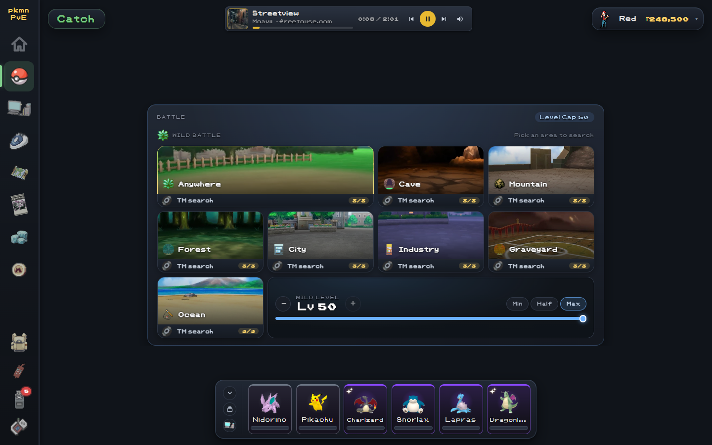
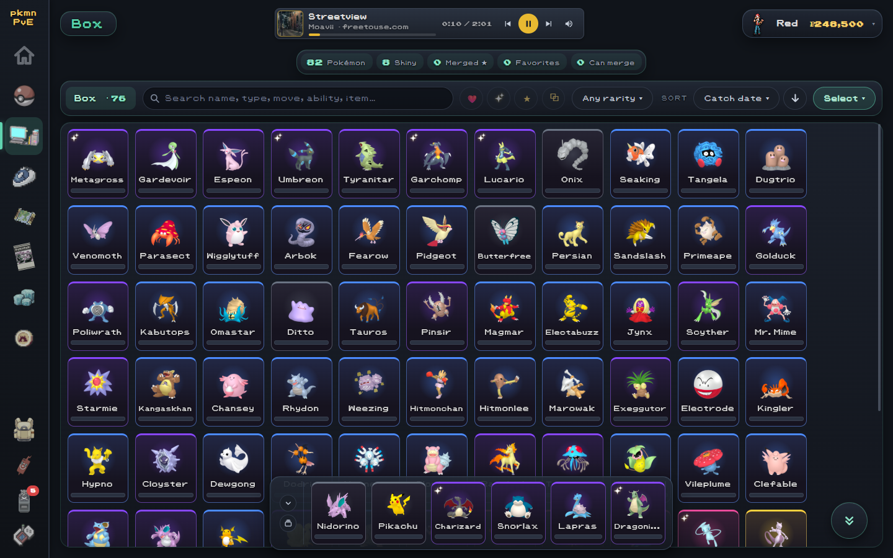
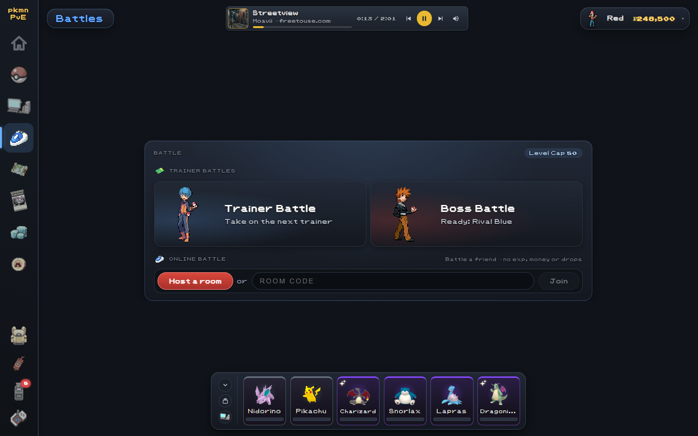
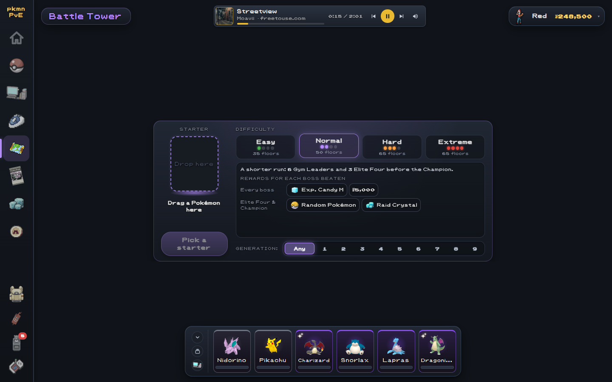
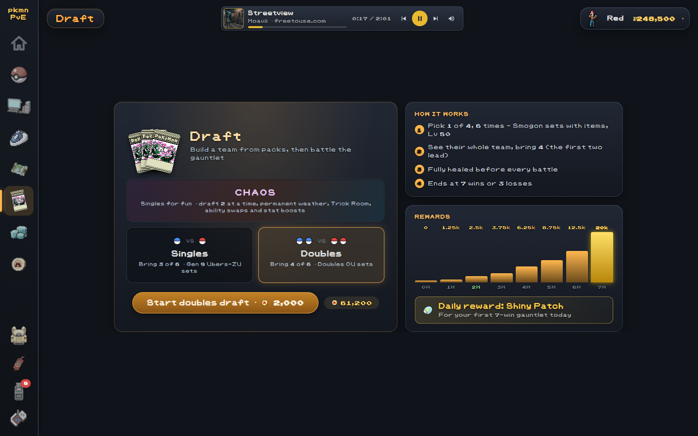
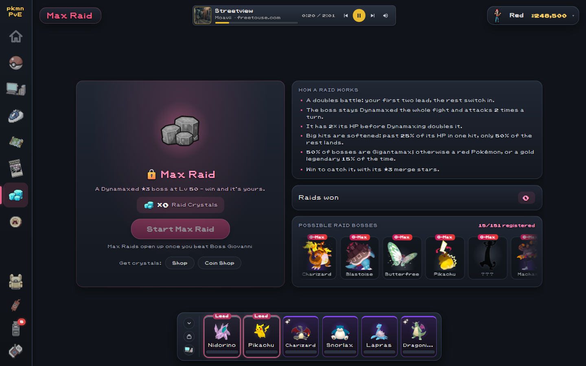
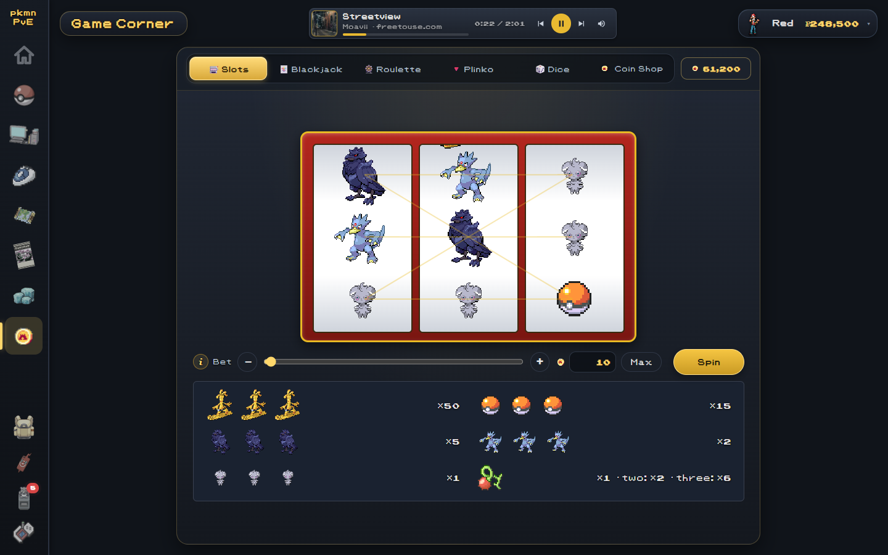
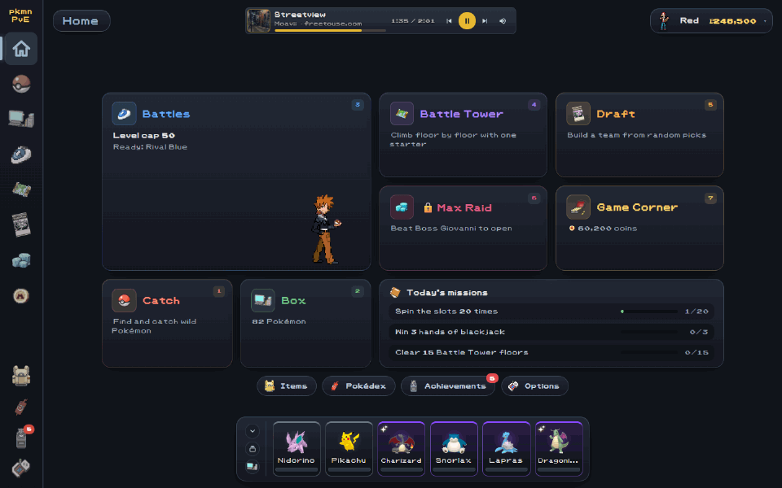

# pkmnPvE

A free, single-player Pokemon game built on the Pokemon Showdown battle engine. Catch Pokemon, build teams, beat trainers and bosses, climb the Battle Tower, draft teams and play the Game Corner.

Runs on Windows (PC) and Android. pkmnPvE is a non-commercial fan project and is not affiliated with Nintendo, Game Freak, Creatures or The Pokemon Company.

## Contents

- [Screenshots](#screenshots)
- [Getting started](#getting-started)
- [Getting around](#getting-around)
- [Money and currencies](#money-and-currencies)
- [Catch](#catch)
- [Box](#box)
- [Battles](#battles)
- [The battle screen](#the-battle-screen)
- [Max Raids](#max-raids)
- [Battle Tower](#battle-tower)
- [Draft](#draft)
- [Game Corner](#game-corner)
- [Items](#items)
- [Missions, achievements and titles](#missions-achievements-and-titles)
- [Pokedex and trainer card](#pokedex-and-trainer-card)
- [Options and saves](#options-and-saves)
- [Credits and license](#credits-and-license)

## Screenshots

| | |
| --- | --- |
|  |  |
| Home | Catch |
|  |  |
| Box | Battles |
|  |  |
| Battle Tower | Draft |
|  |  |
| Max Raid | Game Corner |

## Getting started

- **Install (PC):** download the `-win.zip` from the latest GitHub release, unzip it and run `pkmnPvE.exe`. The game checks for updates itself (Options).
- **Install (Android):** download the `.apk` from the same release and open it on the phone. Installing a newer APK over an old one keeps the save. The app checks for updates too (Options) and opens the new APK in the browser to install.
- **Log in:** type a player name. Each name is its own save on that device.
- **Welcome guide:** a short tour shown before your first starter. It can be reopened from Options > About.
- **Starter:** a new save opens the starter picker: the 27 regional starters, Pikachu, Eevee, or a random unevolved Pokemon.

The game saves by itself as you play.

## Getting around

- **Pages:** Home, Catch, Box, Battles, Battle Tower, Draft, Max Raid and Game Corner. On PC they sit in a rail on the left; on a phone, in a bar along the bottom.
- **Tools:** Items, Pokedex, Rewards (missions and achievements) and Options.
- **Home** shows a card for each page, your daily missions, and banners to continue a Battle Tower run or a draft.
- **Team dock:** your team of six is always on screen, with your companion beside it.
- **Controls:**
  - Number keys 1-7 jump to the Home cards (PC).
  - R presses Run in battle (press again to confirm when asked).
  - Right-click, or hold for half a second, opens a Pokemon's or item's menu.
  - Click and drag any list to scroll it, like a touch screen.
  - On a phone, tap a card or sprite for its details. The back button closes whatever is on top, then returns to Home.

## Money and currencies

| Currency | Earned from | Spent on |
| --- | --- | --- |
| Poke Dollars | Trainers, bosses, selling Pokemon and items, missions, duplicate TMs | The Shop, Poke Balls, coins |
| Coins | Game Corner wins, Draft rewards, missions, achievements; bought with Poke Dollars (10 each) | Game Corner bets, Coin Shop prizes, Draft entry |
| Gems | Battle Tower trainers (1) and bosses (2) | The Battle Tower boss shop (only inside that run) |

Coins are play money only. They can never be bought with real money or cashed out.

## Catch

### Wild battles

- Pick an area: Cave, Mountain, Forest, City, Industry, Graveyard, Ocean or Anywhere. Each area holds the types and egg groups that fit it.
- The **Lab** opens once every boss is beaten. It has its own encounter table and better TM odds.
- **Wild level:** set the highest level wild Pokemon can be, from the minimum up to your level cap.
- Outdoor areas have a 15% chance of starting with sun, rain, sandstorm or snow.
- **Catching:** beat a wild Pokemon, then press Catch. The catch always works and uses one Poke Ball (bought for 200 if you have none).
- **Shinies:** 1 in 512 by default. A shiny gets a star burst when sent out, and leaving one uncaught asks first.
- **Drops:** each wild Pokemon has a 10% chance to drop a random item, plus its own species drop (never above 75%). Pokemon with a friendship evolution can drop a Friendship Petal (15%, late game).
- **After a win:** search the same area again (Find another), catch, or go back.

### DexNav

A key item from the Pokedex Scholar achievement. Pick a registered species and the DexNav shows where it lives and its lowest level.

- In an area where it lives, it appears 15% of the time.
- Each one beaten or caught adds a link to the chain. At 30 links it appears 75% of the time with double shiny odds.
- Running from one or losing to one breaks the chain.
- With the Pokedex Diploma, the DexNav can hunt any Pokemon, forms included.

### TM searches

Each area has 3 searches a day (back at midnight). A search rolls a TM rarity first, then plays a few skill checks:

- A needle spins around a ring. Stop it in the zone for a Good, or in the small slice at its start for a Great.
- Rarer TMs need more checks, with a smaller zone and a faster needle (3 checks for grey, up to 6 for gold).
- A miss knocks progress back a step. Three misses wake a wild Pokemon, which you must fight (no running).
- Every check a Great raises the TM one rarity.
- Pity: 10 searches in one area without purple or better guarantees purple or better next time.
- A TM you already own pays Poke Dollars instead (300 for grey up to 6,000 for gold).

TMs are kept forever and let Pokemon learn those moves in the editor.

**Scanner:** a key item from the Coin Shop (20,000 coins). After each wild win it offers one quick check: a Great has a 15% chance to find a TM (45% for a random item instead), a Good 5% (15%).

## Box

Everything you catch goes to the Box.

- **Team:** drag up to six Pokemon onto the team. Only team Pokemon fight and gain exp.
- **Level cap:** Pokemon cannot level past it. Beating certain bosses raises it.
- **Friendship:** goes up by 10 for each battle won. Friendship evolutions need it maxed (255).
- **Filters and sorting:** search, rarity filter, duplicates filter, sort order, and scroll buttons.
- **Favorites:** a favorited Pokemon is never picked for selling or merging.
- **Loadouts:** save your current team under a name and load it again later.

### The Pokemon menu (right-click)

- **Edit:** moves, held item (from your bag), ability, nature, EVs, IVs, Tera Type, nickname and gender. Includes Auto-fill with ready-made competitive sets, and a Z-Move preview. Moves come from the level-up list and the TMs you own.
- **Evolve:** from the editor once the condition is met (level, item, friendship, or trade).
- **Everstone lock:** stops a Pokemon from evolving, so it can take merges unevolved.
- **Merge:** feed duplicates into a Pokemon (see below).
- **Change Form:** with the matching key item (Rotom, Hoopa, the Forces of Nature, Shaymin, Deoxys, Zygarde, Alcremie, Pikachu).
- **Fuse / Unfuse:** Necrozma, Kyurem and Calyrex with their partners, using the matching key item.
- **Turn Shiny:** uses a Shiny Patch.
- **Max friendship:** uses a Friendship Petal.
- **Companion:** your companion stands beside your team on screen and in battle, in a size you choose. Unlocked by the Best Friends achievement (max a Pokemon's friendship).
- **Sell:** for Poke Dollars by rarity colour (shinies sell for 5,000 more and ask twice).

| Rarity colour | Sell price |
| --- | --- |
| Grey | 150 |
| Blue | 300 |
| Purple | 500 |
| Red | 10,000 |
| Gold | 50,000 |

### Merging

Merge duplicates of the same species (or its pre-evolutions) into one fully evolved or Everstone-locked Pokemon. Merging opens with Max Raids, after beating Boss Giovanni.

- Stars go up each time the copies double: 2 copies = 1 star, 4 = 2 stars, up to 64 copies = 6 stars.
- Each star adds 10% to every stat except HP in Classic battles (7.5% for red Pokemon, 5% for gold). Stats with 0 IVs are not boosted.
- Stars never apply in the Battle Tower, Draft, or online battles (unless the host turns them on).
- A 6-star Pokemon is complete: it takes no more merges and gets a rainbow glow.
- **Select all duplicates** picks every Pokemon that can merge. Optional ticks also spend evolution items, Friendship Petals and Rare Candies to evolve pre-evolutions on the way in.

## Battles

### Trainers and bosses

- **Trainer Battle:** fights the next trainer. Pays 250 per Pokemon on their team, plus item drops. Running costs 200.
- **Boss Battle:** each boss needs a set number of trainer wins first. Bosses pay 2,500 and usually raise the level cap. You cannot run from a boss.
- Prize money grows with your level cap (a cap of 80 adds 80%).
- The boss road covers Kanto and Johto Gym Leaders, your rival, Team Rocket, the Elite Four and the Champion, then post-game bosses up to level 100.
- **Team Rocket:** while a Giovanni fight is next, Trainer Battle only brings Team Rocket members.
- **Late game:** beating Boss Giovanni opens Max Raids and merging, and adds Exp. Candies, evolution items, Raid Crystals, Shiny Patches and Friendship Petals to the shops.
- **Boss Rematch:** once every boss is beaten, fight any boss again. Rematches give no rewards.

### Online battles

Battle a friend on another device.

- One player hosts a room and shares its 5-letter code. The other joins with it.
- Pick singles, doubles, or an online Chaos Draft (see Draft).
- Teams fight as they are in your box. The host can turn merge stars on for both sides.
- Friendly only: no exp, money or drops. Both players need the same game version.
- Co-op Battle Tower runs are also started from a room (see Battle Tower).

## The battle screen

- Pick a move or switch for each of your Pokemon. Tooltips show move power, type matchups and each Pokemon's stats.
- **Gimmicks:** Mega Evolution, Z-Moves, Dynamax and Terastallization, each once a battle as in the main games.
- Weather, terrain, hazards, screens, Substitute and stat changes are all shown on the field.
- **Opponent AI:** Easy, Normal or Hard. Harder AIs use hazards, hazard removal, Counter and Mirror Coat sensibly, and avoid switching into hazards that would knock them out.
- **Run / Forfeit:** Run leaves a wild or trainer battle. Draft matches and Battle Tower fights have Forfeit instead, which counts as a loss.
- Move animation speed can be set to Normal, Fast or Off in Options.

## Max Raids

Open after beating Boss Giovanni. Each raid uses one **Raid Crystal**.

- A doubles battle: your two lead Pokemon against one Dynamaxed boss at your level cap.
- The boss has extra HP, attacks twice a turn, and no single hit can take more than about a quarter of its HP at full strength.
- Bosses are Gigantamax 50% of the time, otherwise a red Pokemon or (15%) a gold legendary.
- **Winning catches the boss** with 3 merge stars, in its Gigantamax form if it had one.
- The Max Raid page shows which Pokemon can appear and the odds of each kind.

## Battle Tower

A run: start with one Pokemon at level 5, climb floor by floor and grow your team. Lose a battle and the run is over. Run Pokemon are copies; your box is never touched.

### Starting a run

- Drop a box Pokemon on the Starter slot.
- Pick a difficulty and (optionally) a generation for the bosses.

| Difficulty | Rules | Rewards per boss beaten |
| --- | --- | --- |
| Easy | 4 Gym Leaders and 2 Elite Four; Normal AI; start with a Full Restore; 1 extra gem per win | Exp. Candy S, 1,000; the Champion gives a Random Pokemon |
| Normal | 6 Gym Leaders and 3 Elite Four | Exp. Candy M, 5,000; Elite Four and Champion each give a Random Pokemon and a Raid Crystal |
| Hard | 8 Gym Leaders and 4 Elite Four; Hard AI; every team has one extra Pokemon | Random Pokemon, Raid Crystal, Exp. Candy M, 10,000; the Champion gives a Random Legendary |
| Extreme | Hard, plus Hard AI for wild Pokemon, full boss teams and no healing at all | Random Legendary, 2 Raid Crystals, Exp. Candy L, 20,000 |

Rewards are paid into your normal bag and wallet when the run ends, whether it was won or lost.

### Floors

Every 5th floor is a boss: the Gym Leaders, then the Elite Four, then the Champion, whose defeat wins the run. Other floors offer a choice of paths:

- **Wild:** beat it to add it to your team (up to 6).
- **Trainer:** a battle that pays a gem and an item reward.
- **Item:** choose one of three held items (can be rerolled once).
- **Rest:** a Pokemon Center that heals the team.
- **New Ability / New Move:** pick one of four to give a team member. Taught moves stay through evolution.
- **Random Swap:** swap one Pokemon, or the whole team, for random new ones (sometimes legendaries).

Other rules:

- HP and status carry between battles. Bosses heal the team when beaten (except on Extreme).
- Your team levels up each floor, up to the run's level cap, which rises with each boss. Weaker members catch up faster.
- In a run, a Pokemon can learn any move its species ever could, and its moves can be edited between floors.
- **Villain Takeover:** a 10% chance a villain takes over a floor. Every other tile costs up to 3 gems; fighting the villain is free and rewards one of three Pokemon.
- **Boss floor shop:** spend gems on a Full Restore (3), Revive (5), Ability Capsule (1), Rare Candy (1), or an extra item, ability, move or swap pick.

### Co-op runs

Start a run with a friend from an online room. Each player picks a starter, keeps a team of up to 3, and plays the same floors. Bosses and villains are fought together in doubles, both teams on one side. If either team is wiped, the run ends for both. Each player's run is saved to continue later.

## Draft

Build a whole team from random picks, then test it. Costs 2,000 coins to enter.

- Six rounds, each a pack of 4 Pokemon with full competitive sets at level 50. Pick one from each.
- **Singles:** bring 3 of your 6 each battle, after seeing the opponent's team. Drafts from two adjacent Gen 9 tiers (Ubers down to ZU).
- **Doubles:** bring 4, drafted from Doubles OU sets.
- The gauntlet ends at 7 wins or 3 losses. Coins paid by wins: 0, 1,250, 2,500, 3,750, 6,250, 8,750, 12,500, 20,000.
- Winning every battle of a gauntlet gives a Shiny Patch the first time each day.

### Chaos Draft

A singles draft just for fun, with the same 7-win / 3-loss gauntlet.

- Draft 2, take a modifier, then fight a hard trainer with as many Pokemon as you. Two more picks come after the 1st, 3rd and 5th battles until your team is full.
- A modifier step comes after every battle and offers 5 at random. You can reroll once per step and swap one held item for free.
- **Battle-start modifiers:** weather, terrain, Trick Room, Tailwind, Reflect and Light Screen, entry hazards on the foe, or Intimidate (foe's lead starts at -1 Attack, Sp. Atk and Speed).
- **Pokemon modifiers** (at most 2 per Pokemon): new ability, +50% to a stat, Move Tutor (any move), Glass Cannon, Fortress, Wild Card (swap for a random Pokemon from the tier above), Lock-On (moves never miss).
- Opponents get modifiers too, and you can hover them to see which.
- **Online Chaos Draft:** both players draft at the same time from the same tiers, then battle each other. First to 4 wins takes the match; after 7 battles, the most wins does.

## Game Corner

Played with coins. Bets go up to 1,000 coins (10,000 with the High Roller title). Each game shows badges for the titles that affect it.

- **Slots:** three reels, five lines (three rows and two diagonals). Gholdengo is the jackpot (x50). Cherries on the first reel pay on their own. Pays back about 101.5% over time.
- **Blackjack:** six-deck shoe, dealer stands on 17. Hit, stand or double down. Blackjack pays 3:2, a win 1:1, a tie returns the bet.
- **Roulette:** a European wheel (0-36). Bet on single numbers, dozens, columns, red/black, odd/even and low/high.
- **Plinko:** drop a ball through 12 rows of pegs into 13 slots. Low, Medium or High risk; High pays up to x110 at the edges.
- **Dice:** set a divider from 2 to 98 and bet the roll lands over or under it. Payout is 99 divided by your chance to win.
- **Random Pokemon cases:** open Random Pokemon, Random Legendary and Lock Capsule items on a spinning reel. The result can be kept, sold or merged straight away.

### Coin Shop (Prize Exchange)

- **Buy coins:** packs of 100, 500, 1,000 or 5,000 at 10 Poke Dollars each. Daily offer: 2,500 coins for 15,000.
- **Prizes:** Lock Capsule (200), Rare Candy (100), Exp. Candy M (1,000), Exp. Candy L (2,000), Random Pokemon (1,000), Raid Crystal (5,000), Shiny Patch (5,000, one a day), Random Legendary (20,000).
- **Daily petals:** 5 free Friendship Petals a day, plus a pack of 10 for 10,000 coins once a day.
- **TMs of the day:** 12 TMs, including some only sold here.
- **Pokemon of the day:** a legendary, mythical, Ultra Beast or Paradox Pokemon that arrives with 2 merge stars.
- **Key item:** the Scanner (20,000).

## Items

The Items window holds both your bag and the Shop. Click an item to see it, use it, buy (x1 / x5 / x10) or sell it. Category buttons jump the list, and Quick sell clears items that do nothing (Bottle Caps, Rare Bones, Pretty Feathers).

- **Poke Balls:** one per catch.
- **Held items, Mega Stones, Z-Crystals and berries:** given to Pokemon in the editor.
- **Evolution items:** stones, Link Cable (for trade evolutions) and the rest.
- **Rare Candy:** one level (up to the cap). **Exp. Candy S / M / L:** 10,000 / 50,000 / 100,000 exp to every team member.
- **Random Pokemon:** a random unevolved Pokemon. **Random Legendary:** a random legendary, mythical, Ultra Beast or Paradox Pokemon. **Lock Capsule:** a random Shop item, rarer the pricier.
- **Shiny Patch:** makes one Pokemon shiny. **Friendship Petal:** maxes one Pokemon's friendship.
- **Raid Crystal:** starts one Max Raid.
- **Fossils:** restored into a Pokemon for 100, a little under your level cap. The Galar fossils must be paired, and the pair decides the result.
- Items are coloured by Shop price: grey, then blue from 1,000, purple from 5,000, red from 7,500 and gold from 20,000.

### Key items

Kept forever, never sold. Earned from achievements unless noted.

| Key item | Effect | Source |
| --- | --- | --- |
| Exp. Charm | 1.5x exp from battles | Seasoned Battler |
| Shiny Charm | 3x wild shiny odds | Professor |
| Friendship Charm | Double friendship from battles | Evolution Expert |
| Catching Charm | Half of all catches are free | Pokemon Hunter |
| Item Charm | Wild drop chances +15 points | Elite Challenger |
| DexNav | Hunt one species in the wild | Pokedex Scholar |
| Pokedex Diploma | DexNav can hunt any Pokemon | Pokedex Complete |
| Scanner | Quick TM check after wild wins | Coin Shop |
| Rotom Catalog, Prison Bottle, Reveal Glass, Gracidea, Meteorite, Zygarde Cube, Decoration Box, Fashion Case | Change forms | Owning that Pokemon (or its forms) |
| N-Solarizer, N-Lunarizer, DNA Splicers, Reins of Unity | Fuse legendaries | Owning that Pokemon |

## Missions, achievements and titles

### Daily missions

Three a day (easy, medium, hard), reset at local midnight. Each pays money, coins or items when claimed, and finishing all three pays 2 Raid Crystals. One mission a day can be rerolled.

### Achievements

Grouped into Battle, Collection, Merges and Raids, Battle Tower, Draft, TMs, Game Corner, and Secret. Rewards include items, coins, key items, gift Pokemon and titles. Claim them from Rewards.

### Titles

Each title comes from an achievement and gives a permanent perk. Perks stack and can be turned off one by one. The title shown beside your name is just for show. Five-Star and Gigantamax Hunter cannot be on together.

| Title | Perk |
| --- | --- |
| Veteran | Double exp from battles |
| Ace Trainer | +50% prize money from trainers and bosses |
| Badge Collector | 50% chance of a bonus Rare Candy after any battle won |
| Champion | Running from trainers is free |
| Collector | 25% chance a catch is free |
| Professor | Unregistered Pokemon appear more often; DexNav chain maxes at 20 |
| Shiny Hunter | Wild shiny odds 1 in 384 |
| Legend Keeper | Random Legendary more often gives a box legendary |
| Tycoon | 25% off when buying 5 or more of an item |
| Survivor | Battle Tower runs start with a free item pick |
| Daredevil | Battle Tower runs start with a free move and ability pick |
| Golden Touch | Slots jackpot pays x75, every slots win 10% more |
| High Roller | Bet up to 10,000 coins |
| Edge Lord | Plinko edge slots pay double, the next ones 25% more |
| Heartless | Pokemon sell for 15% more |
| Broker | Grey, blue and purple Pokemon sell for double |
| 9+10 | Blackjack pays 4:1, a regular win 3:2 |
| Five-Star | Gold legendaries appear twice as often as raid bosses |
| Alchemist | 10% chance of an evolution item when selling a Pokemon |
| Raid Leader | Raid bosses are caught with 2 extra copies |
| Gigantamax Hunter | Raid bosses Gigantamax 65% of the time |
| Starlight | Raid bosses 3x as likely to be shiny (5x with the Shiny Charm) |
| Diligent | One extra daily mission reroll |
| Croupier | Losing roulette spin: 10% refund; winning spin: 10% chance of double winnings |
| Long Shot | The same as Croupier, for Dice |
| Grand Drafter | Drafts cost 25% less |
| Prospector | Gold TMs found twice as often |
| Light Sleeper | One extra miss allowed in a TM search |
| Walking Disc | Duplicate TMs pay double; new TMs turn up more often |
| Specialist | 50% chance a successful TM search is refunded |
| Steady Hands | The Great slice is 50% wider |
| Hex Master | One check can fall short of a Great and still raise the rarity |
| Unstoppable | The Scanner's quick check finds TMs twice as often |
| AFK | A missed check does not set a TM search back |

## Pokedex and trainer card

- **Pokedex:** every National Dex species and alternate form, with its rarity colour and hints on where to find it. A pop-up appears for each new registration; click it to open that entry. Completing the National Dex turns the Pokedex header and your name in battle gold.
- **Trainer card:** click your trainer to change your sprite and title, turn title perks on or off, see your road to the League, and view statistics (trainers and bosses defeated, wild Pokemon beaten and caught, raids won, best Battle Tower floor).

## Options and saves

- **Updates:** checks for new versions each time Options opens. On PC, Update now downloads and installs it, then restarts the game. On Android, Download update opens the new APK in the browser: open it when it finishes and tap Update to install it over the old copy. Saves are kept either way.
- **Sound:** separate volumes for menus, cries, music and the Game Corner. The music player in the top bar can pause or skip tracks.
- **Screen size (PC):** Auto, a fixed 75% to 150%, or Mobile (the phone layout in a phone-shaped window).
- **Move animations:** Normal, Fast or Off.
- **Sprite style (PC):** 2D, 2D Animated, 3D or 3D Animated.
- **Background:** the default, or your own picture.
- **Saves:**
  - **Send to another device:** press Send, then enter the 5-letter code (or scan the QR code) on the other device. Works PC to phone and back. Both need the game open and internet.
  - **Save file:** export your save as a `.pkmnsave` file, and import one back. Importing backs up the current save first.
  - Saves live only on the device. Export one now and then, especially before reinstalling or switching devices.
- **About:** the welcome guide, sprite credits, and a bug report link (attach `errors.log` from the log folder on PC).
- **Account:** log out to switch player.

## Credits and license

- Battles run on [Pokemon Showdown](https://github.com/smogon/pokemon-showdown) (MIT License, Guangcong Luo and contributors).
- Full third-party notices are in [THIRD_PARTY_NOTICES.md](THIRD_PARTY_NOTICES.md). Sprite credits are in-game under Options > About.
- The game's own code is under the [MIT License](LICENSE).
- Report bugs on the [GitHub issues page](https://github.com/markconway09/pkmnPvE/issues/new).
